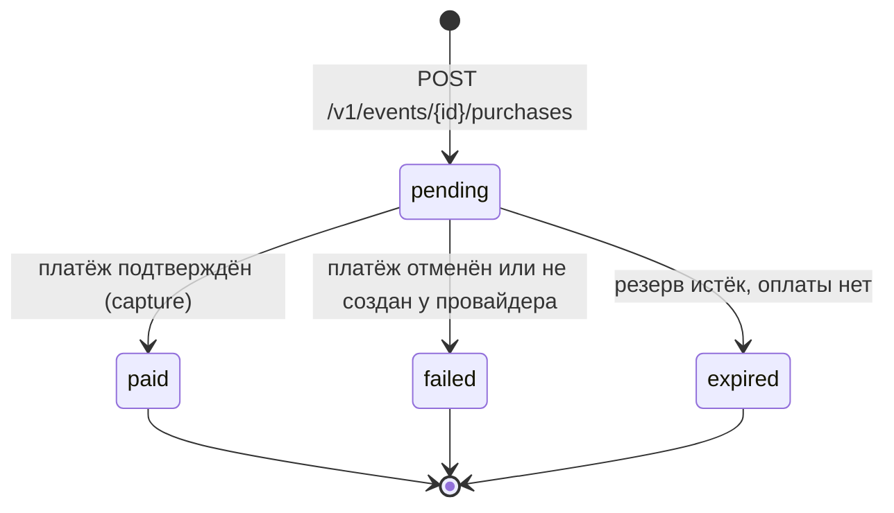
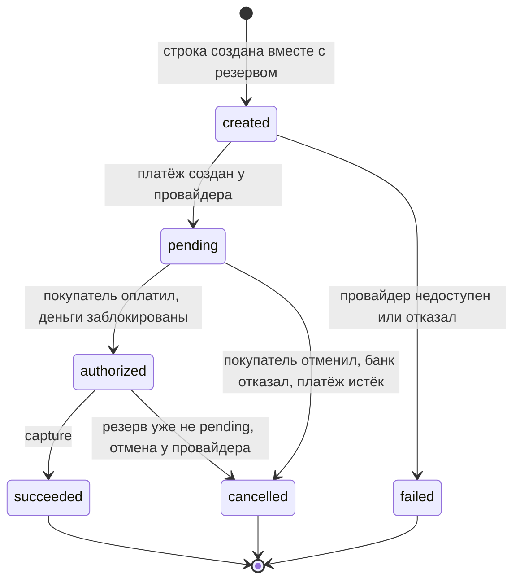
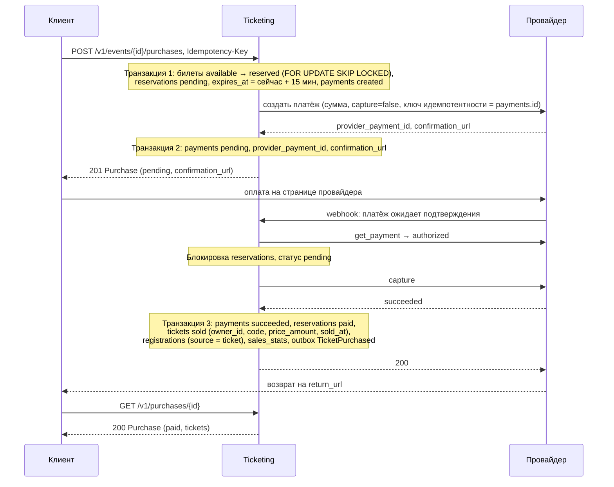

# Продажа и покупка билетов: сценарий оплаты

Требования: #18099 (настройка продажи), #18114 (покупка билета). Реализация - Спринт 3.
Таблицы - в [модели данных](data-model.md), запросы - в [OpenAPI](openapi.yaml) (тег `sales`).

## Участники

- **Клиент** (Android, веб) - создаёт покупку, открывает страницу оплаты провайдера, после возврата
  опрашивает `GET /v1/purchases/{id}`.
- **Ticketing** - резервирует билеты, создаёт платёж, принимает уведомления провайдера, выдаёт билеты.
- **Платёжный провайдер** - страница оплаты и уведомления (webhook) об изменении статуса платежа.
  Ticketing работает с ним через интерфейс `PaymentProvider`, поэтому провайдер меняется без изменения
  сценария. Кандидат - ЮKassa.

## Решения

1. **Двухстадийная оплата.** Деньги сначала блокируются у покупателя (`authorized`), списываются
   только когда Ticketing подтвердит платёж (capture). Подтверждаем, только если резерв ещё держится.
   Если резерв уже истёк, отменяем платёж, и банк снимает блокировку. Так поздняя оплата никогда не
   списывает деньги за билеты, которые уже вернулись в продажу, и возвраты не нужны.
   Это требование к выбору провайдера: у ЮKassa такая оплата есть (`capture: false`).
2. **Вызов провайдера вне транзакции резерва.** Резерв билетов фиксируется отдельной транзакцией,
   платёж у провайдера создаётся после неё. Строки `tickets` не остаются заблокированными на время
   сетевого запроса.
3. **Статусу из уведомления не верим.** Из тела webhook берём только `provider_payment_id`,
   актуальный статус запрашиваем у провайдера (`PaymentProvider.get_payment`). Поддельное или
   устаревшее уведомление ничего не изменит. Если у провайдера есть подпись или список IP,
   они проверяются дополнительно.
4. **Решение принимается под блокировкой резерва.** Webhook и фоновая задача истечения блокируют
   строку `reservations` (`SELECT ... FOR UPDATE`, задача - со `SKIP LOCKED`). Что делать с
   платежом, определяет статус резерва в этот момент, а не порядок прихода уведомлений.
5. **Пока билеты не вернулись в продажу, оплата принимается**, даже если `expires_at` уже прошёл:
   задача истечения могла ещё не дойти до резерва. После перехода резерва в `expired` оплата
   отменяется.

## Статусы

### Покупка (`reservations.status`)

| Статус | Билеты | Что показывает клиент (#18114) |
|---|---|---|
| `pending` | `reserved` | Ожидание оплаты, кнопка «Оплатить» ведёт на `confirmation_url` |
| `paid` | `sold` | Билеты (`tickets`) с кодом для QR |
| `failed` | `available` | «Оплата не прошла. Попробуйте ещё раз.» |
| `expired` | `available` | «Покупка отменена. Билет не создан.» |

`paid`, `failed` и `expired` - конечные: из них покупка никуда не переходит.
Повторная попытка - новая покупка с новым `Idempotency-Key`.

### Платёж (`payments.status`)

Статусы ЮKassa: `pending` → `pending`, `waiting_for_capture` → `authorized`, `succeeded` → `succeeded`,
`canceled` → `cancelled`.

Статус меняется только вперёд по схеме. Уведомление, которое требует перехода назад или в тот же
статус, ничего не меняет.

### Билет (`tickets.status`)

`available` → `reserved` при создании покупки; `reserved` → `sold` при оплате;
`reserved` → `available` при `failed` или `expired`. Проданный билет не возвращается в продажу.

## Сценарии

### 1. Успешная покупка

- Перед резервом проверяется: мероприятие платное и не прошло (events-service), продажа настроена
  и открыта (`ticket_sales_settings.sales_open`), свободных билетов не меньше `quantity`.
- `total_amount` фиксируется при резерве. Изменение цены в настройках не меняет уже созданные покупки.
- При оплате создаётся запись `registrations` (`status = going`, `visibility = public`,
  `source = ticket`). Если у пользователя уже есть запись на это мероприятие (вторая покупка),
  новая не создаётся. Для новой записи в outbox пишется `RegistrationChanged` (`created`).
- `TicketPurchased` уходит в outbox той же транзакцией: Notifications отправит письмо с билетом.
- После возврата клиент опрашивает `GET /v1/purchases/{id}` раз в 2 секунды, пока статус `pending`.
  Уведомление провайдера может прийти позже возврата пользователя.

### 2. Отказ в оплате

Покупатель отменил оплату, банк отклонил карту или провайдер сам отменил платёж.

1. Webhook → `get_payment` возвращает `cancelled`.
2. Под блокировкой резерва: `payments.status` → `cancelled`; если покупка `pending`, она переходит
   в `failed`, билеты → `available`.
3. Ответ провайдеру 200. Клиент по статусу `failed` показывает «Оплата не прошла. Попробуйте ещё раз.»

Если провайдер недоступен при создании платежа (ошибка или таймаут), покупка сразу переходит
в `failed`, билеты возвращаются в продажу, платёж - `failed`, клиент получает 502
`payment_provider_error`. Платёж мог успеть создаться у провайдера, но `confirmation_url` клиент
не получил и оплатить его не сможет. Если уведомление о нём всё же придёт, оно попадёт в сценарий 4.

### 3. Повторное уведомление

Провайдер повторяет уведомление, пока не получит 200, и может прислать их не по порядку.

- Обработка идемпотентная: статус берётся у провайдера, переходы - только вперёд, под блокировкой
  резерва. Повтор находит платёж уже в конечном статусе и ничего не меняет.
  Повторных билетов, записей, событий и строк в `sales_stats` не будет.
- `capture` для уже подтверждённого платежа не вызывается: платёж в `succeeded` не обрабатывается.
- Уведомление о неизвестном `provider_payment_id` - ответ 200 и предупреждение в лог.
  Иначе провайдер повторял бы его сутки.
- Ошибка базы или провайдера во время обработки - ответ 500, провайдер повторит уведомление.
  Изменения откатываются целиком, поэтому повтор начинает с того же состояния.
- Отдельная таблица обработанных уведомлений не нужна: состояние хранится в `payments` и `reservations`.

### 4. Просроченный резерв

Фоновая задача раз в минуту выбирает покупки `pending` с прошедшим `expires_at`
(`FOR UPDATE SKIP LOCKED`, индекс `(status, expires_at)`). Для каждой покупки:

1. Запрашивает статус платежа у провайдера.
2. `authorized` - покупатель успел оплатить, билеты ещё в резерве: capture и обработка как в
   сценарии 1.
3. `succeeded` - обработка как в сценарии 1 без capture.
4. `pending`, `cancelled` или платёж не создан - покупка → `expired`, билеты → `available`,
   платёж → `cancelled`. Платёж в `pending` отменяется у провайдера, если провайдер это позволяет.
   Иначе он истечёт у провайдера сам.
5. Провайдер недоступен - покупка пропускается до следующего запуска. Билеты остаются в резерве
   на минуту дольше, зато оплаченная покупка не потеряется.

Если покупатель оплатил после того, как покупка стала `expired`, webhook придёт с `authorized`.
Ticketing отменит платёж у провайдера, и банк снимет блокировку. Деньги не списываются,
билеты не выдаются, покупка остаётся `expired`.

### 5. Повтор запроса покупки

Клиент повторяет `POST /v1/events/{id}/purchases`, если не дождался ответа.

- Тот же `Idempotency-Key` от того же пользователя возвращает уже созданную покупку в её текущем
  статусе (200 вместо 201). Второй резерв не создаётся. Уникальность в базе -
  (`user_id`, `idempotency_key`): два одновременных запроса не создадут две покупки.
- Тот же ключ с другим мероприятием или количеством - 409 `idempotency_key_reused`.

## Заглушка провайдера

Пока провайдер не выбран и для демо, `PAYMENT_PROVIDER=stub` подключает заглушку `PaymentProvider`.
Сценарий и API для клиента те же:

- `confirmation_url` ведёт на страницу заглушки с кнопками «Оплатить» и «Отменить»;
- кнопки вызывают ту же обработку, что и webhook: `authorized` → capture → `succeeded` или `cancelled`;
- заглушка не включается при `ENVIRONMENT=production`.

Android и веб делают покупку на заглушке, переход на настоящего провайдера меняет только настройки
сервиса.

## Настройки (Спринт 3)

| Переменная | По умолчанию | Что это |
|---|---|---|
| `PAYMENT_PROVIDER` | `stub` | `stub` или выбранный провайдер |
| `PAYMENT_SHOP_ID`, `PAYMENT_SECRET_KEY` | - | Доступ к API провайдера |
| `PAYMENT_RETURN_URL` | - | Куда провайдер вернёт покупателя, `{purchase_id}` подставляется |
| `RESERVATION_TTL_MINUTES` | `15` | Сколько держится резерв |
| `RESERVATION_EXPIRY_POLL_SECONDS` | `60` | Как часто задача истечения ищет просроченные резервы |

## Что согласовать

- С Android и вебом: адрес возврата после оплаты (deep link приложения и страница веба),
  опрос `GET /v1/purchases/{id}` после возврата, тексты для `failed` и `expired` из #18114.
- С командой: провайдер с двухстадийной оплатой и тестовым магазином до начала Спринта 3.
